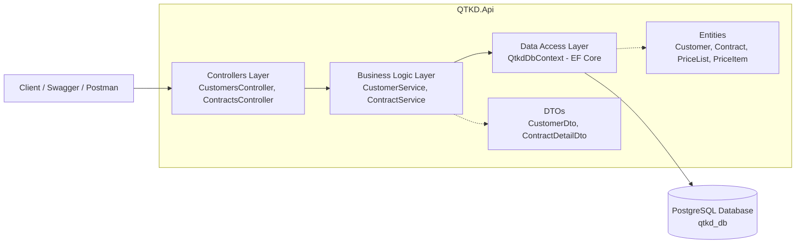

# Hệ thống Quản trị Kinh doanh (QTKD) - Phase 2

Dự án thực hành xây dựng hệ thống Quản trị Kinh doanh (Quản lý Khách hàng, Hợp đồng, Bảng giá) sử dụng ASP.NET Core Web API, Entity Framework Core và PostgreSQL.

## 1. Sơ đồ kiến trúc các thành phần chính của Solution



## 2. Yêu cầu môi trường
- .NET SDK (phiên bản 8.0 trở lên)
- PostgreSQL (phiên bản 14 trở lên)
- Công cụ `dotnet-ef`: `dotnet tool install --global dotnet-ef`

## 3. Hướng dẫn cấu hình Database
Dự án không lưu mật khẩu cơ sở dữ liệu trực tiếp trên Git. Sau khi clone repository về máy, hãy cấu hình chuỗi kết nối PostgreSQL bằng **User Secrets** (hoặc chỉnh sửa trong `appsettings.Development.json`):

```bash
dotnet user-secrets init --project QTKD.Api
dotnet user-secrets set "ConnectionStrings:DefaultConnection" "Host=localhost;Port=5432;Database=qtkd_db;Username=postgres;Password=MAT_KHAU_CUA_BAN" --project QTKD.Api
```

## 4. Chạy Migration và khởi tạo dữ liệu mẫu
Từ thư mục gốc của Solution (`QTKD`), chạy lệnh sau để tạo cơ sở dữ liệu, các bảng và tự động nạp dữ liệu mẫu (2 Customer, 1 Contract Draft, 1 PriceList và 2 PriceItem):

```bash
dotnet ef database update --project QTKD.Api
```

## 5. Khởi động API và Kiểm thử Endpoints
Chạy ứng dụng:

```bash
dotnet run --project QTKD.Api
```

Truy cập Swagger UI tại `http://localhost:<port>/swagger` hoặc dùng `curl`/Postman để thử nghiệm 2 endpoint:
1. **Lấy danh sách khách hàng:**
   - `GET /api/customers`
2. **Xem chi tiết hợp đồng theo ID:**
   - `GET /api/contracts/1`